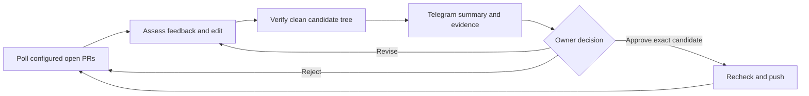

# ReviewLoop

Agents handle your PR feedback while you do other work. You approve every push.

ReviewLoop is a Linux-first supervisor for your open pull requests in explicitly configured repositories you control. It polls GitHub, asks a coding agent to assess feedback and prepare changes, runs the repository's configured checks, and sends you the result through Telegram. Publishing requires your approval of the exact candidate commit. It does not merge PRs.

**Version 0.2.0 upgrades the coding runtime and adds a repair benchmark.** Pi Agent core drives the tool loop, and a pinned Codex executable applies patches inside the worker sandbox. Real-model coding quality and deployment isolation have not been qualified. See [recorded validation](docs/VALIDATION.md), [operations](docs/OPERATIONS.md), and [security boundaries](docs/SECURITY.md).

## Install from source

Prerequisites: Node.js 24 or newer, npm, Git, and rootless Podman (or explicitly configured rootless Docker). Install those through your normal approved system tooling. The worker image needs `/bin/sh`, GNU `/usr/bin/timeout`, the pinned Codex patch helper, and your repository's test/build dependencies. ReviewLoop never builds or pulls an image or installs repository dependencies automatically.

```sh
npm ci
npm run check
npm test
npm run build
npm link
reviewloop --help
```

Alternatively, run `npm pack` and install the resulting package with `npm install -g /path/to/package.tgz`. Use a user-owned npm prefix; these instructions do not require root. Neither method signs you into any service.

Build the provided worker image explicitly on the intended rootless Linux host:

```sh
podman build -f containers/Containerfile -t localhost/reviewloop-worker:0.2.0 .
```

This command downloads the base image and pinned public Codex package. Extend the image with any repository-specific dependencies, set `runtime.image` to the resulting tag, and [qualify the runtime/image](docs/OPERATIONS.md#qualify-the-real-sandbox-before-inference) before using it for model-generated commands.

## Configure before running

```sh
reviewloop init --config ./reviewloop.json
```

Edit the generated configuration. Set your GitHub username, repository allowlist, exact check commands, a preloaded image, private state directory, Telegram owner/chat IDs and resource limits. Keep configuration and state outside monitored workspaces. The intended Bedrock defaults are configurable: model `us.anthropic.claude-sonnet-5`, region `us-east-2`.

Secrets are read from environment variables named by the configuration. See [the environment template](scripts/reviewloop.env.example); never put tokens into command arguments, Git, or PR comments. A Bedrock bearer API key is not an IAM access-key pair. Short-lived keys need an approved renewal mechanism. The `us.` inference profile can route across US and Canada; the request region is not a single-region residency guarantee.

Dollar limits are disabled in the generated example until configured. They require current input/output prices supplied by you. Example limits are proposals, not permission to spend, and token-based estimates are not an AWS billing guarantee. Step, token and time limits still matter. Do not run a real pilot until you have reviewed these limits and the credentials' scope.

```sh
reviewloop doctor --config ./reviewloop.json
reviewloop run --config ./reviewloop.json --once
```

`run --once` performs real work when valid credentials and eligible PRs exist; it is not a dry run. For continuous monitoring, omit `--once`. [Linux service setup](docs/OPERATIONS.md#linux-user-service) is optional.

## What you control

- Which repositories are monitored; defaults to your own open PRs; optional per-repository `authors` and `pullRequests` explicitly narrow or change eligibility.
- Provider/model, region, check commands, sandbox image, resource limits and approval expiry.
- Durable preferences through `preferences add`, `preferences list` and `forget`; preferences cannot grant tools, bypass approval or change security policy.
- Whether a candidate is pushed, rejected, or revised. Fresh feedback or a changed branch can invalidate a pending candidate.

Use `status`, `jobs` and `show JOB_ID` for the current state and evidence. The agent can read/edit files and run bounded commands in its workspace; test success is evidence, not a proof of correctness.

## Architecture and reuse

TypeScript controller + SQLite state, Git/Octokit, official AWS Bedrock SDK, isolated execution and Telegram Bot API. The model interface is replaceable; Bedrock and an explicit OpenAI-compatible endpoint are the provider choices in the configuration contract. No silent model fallback.

The controller embeds Pi Agent core 0.99.1 with sequential confined tools and an adapter to ReviewLoop's configured model provider. Bedrock continues through the official AWS SDK. `apply_patch` calls Codex 0.159.0's native patch engine inside the sandbox; it does not invoke the full Codex agent or send inference to OpenAI. DeepSeek Harness is a design reference, not an embedded dependency. [Exact reuse and licenses](docs/REUSE.md), [runtime decision](docs/ADR-002-HARNESS.md).

Complete tool rounds are checkpointed outside the worker workspace. A matching checkpoint can resume after interruption; invalid or changed workspace state is rejected. Owner revisions can start from the prior verified candidate when its original head and policy still match, then require fresh checks and approval. Budgets remain shared across the revision group.



The coding worker receives task context, not permission to publish or read controller credentials. Only the configured Telegram owner/chat can approve; CLI inspection and preferences do not provide an approval bypass.

## Evaluate repair quality

Validate the four fixture oracles without model calls or GitHub/Telegram credentials:

```sh
reviewloop evaluate --reference --output /tmp/reviewloop-reference-UNIQUE
```

Use a new output directory each time. Reference mode runs trusted local fixtures and explicitly reports **fixture validation, not model evaluation**. To evaluate the configured model after qualifying the rootless worker and reviewing its budgets:

```sh
reviewloop evaluate --allow-model-calls --config reviewloop.json --output /tmp/reviewloop-model-UNIQUE
```

Add `--task retry-after` to select one task. The runner hides acceptance tests and reference solutions until coding ends, verifies a frozen candidate, and reports visible checks, hidden checks, changed-path constraints, usage and latency separately. It reserves budget before calls and carries pilot limits across selected tasks. [Benchmark protocol and limitations](evals/README.md). Four synthetic tasks cannot establish Codex-level quality; no live model score is recorded yet.
