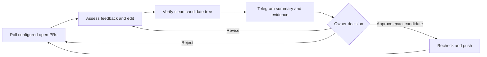

# ReviewLoop

Agents handle your PR feedback while you do other work. You approve every push.

ReviewLoop is a Linux-first supervisor for your open pull requests in explicitly configured repositories you control. It polls GitHub, asks a coding agent to assess feedback and prepare changes, runs the repository's configured checks, and sends you the result through Telegram. Publishing requires your approval of the exact candidate commit. It does not merge PRs.

**This is an early MVP.** Local deterministic tests and a real credentialed pilot are different acceptance gates. Do not infer production readiness from a green test suite. See [operations](docs/OPERATIONS.md) and [security boundaries](docs/SECURITY.md).

## Install from source

Prerequisites: Node.js 24 or newer, npm, Git, and rootless Podman (or explicitly configured rootless Docker). Install those through your normal approved system tooling. Prepare a trusted container image with `/bin/sh`, GNU `/usr/bin/timeout`, and your repository's test/build dependencies; ReviewLoop does not pull an image or install repository dependencies automatically.

```sh
npm ci
npm run check
npm test
npm run build
npm link
reviewloop --help
```

Alternatively, run `npm pack` and install the resulting package with `npm install -g /path/to/package.tgz`. Use a user-owned npm prefix; these instructions do not require root. Neither method signs you into any service.

## Configure before running

```sh
reviewloop init --config ./reviewloop.json
```

Edit the generated configuration. Set your GitHub username, repository allowlist, exact check commands, a preloaded image, private state directory, Telegram owner/chat IDs and resource limits. Keep configuration and state outside monitored workspaces. The intended Bedrock defaults are configurable: model `us.anthropic.claude-sonnet-5`, region `us-east-2`.

Secrets are read from environment variables named by the configuration. See [the environment template](scripts/reviewloop.env.example); never put tokens into command arguments, Git, or PR comments. A Bedrock bearer API key is not an IAM access-key pair. Short-lived keys need an approved renewal mechanism. The `us.` inference profile can route across US and Canada; the request region is not a single-region residency guarantee.

Dollar limits are disabled in the generated example until configured. They require current input/output prices supplied by you. Example limits are proposals, not permission to spend, and token-based estimates are not an AWS billing guarantee. Step, token and time limits still matter. Do not run a real pilot until you have reviewed these limits and the credentials' scope.

```sh
reviewloop doctor --config ./reviewloop.json
reviewloop run --config ./reviewloop.json --once
```

`run --once` performs real work when valid credentials and eligible PRs exist; it is not a dry run. For continuous monitoring, omit `--once`. [Linux service setup](docs/OPERATIONS.md#linux-user-service) is optional.

## What you control

- Which repositories are monitored; defaults to your own open PRs; optional per-repository `authors` and `pullRequests` explicitly narrow or change eligibility.
- Provider/model, region, check commands, sandbox image, resource limits and approval expiry.
- Durable preferences through `preferences add`, `preferences list` and `forget`; preferences cannot grant tools, bypass approval or change security policy.
- Whether a candidate is pushed, rejected, or revised. Fresh feedback or a changed branch can invalidate a pending candidate.

Use `status`, `jobs` and `show JOB_ID` for the current state and evidence. The agent can read/edit files and run bounded commands in its workspace; test success is evidence, not a proof of correctness.

## Architecture and reuse

TypeScript controller + SQLite state, Git/Octokit, official AWS Bedrock SDK, isolated execution and Telegram Bot API. The model interface is replaceable; Bedrock and an explicit OpenAI-compatible endpoint are the provider choices in the configuration contract. No silent model fallback.

This is a custom controller and tool loop informed by official DeepSeek Harness and Codex patterns. It does **not** embed either runtime. [Exact reuse and licenses](docs/REUSE.md).



The coding worker receives task context, not permission to publish or read controller credentials. Only the configured Telegram owner/chat can approve; CLI inspection and preferences do not provide an approval bypass.
