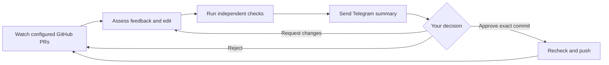

# ReviewLoop — self-hosted AI agent for GitHub pull requests

**Agents handle your PR feedback while you do other work. You approve every push.**

ReviewLoop watches your open pull requests, uses an AI coding agent to assess review feedback and prepare fixes, runs your checks, and sends the result to Telegram. Reply with changes or approve the exact commit before it is pushed. It runs on your Linux machine with AWS Bedrock and keeps preferences, job history and approval decisions in local SQLite state.

[](https://github.com/cvsgireesh/reviewloop/actions/workflows/ci.yml)
[MIT license](LICENSE) · [Setup](#quick-start) · [Operations](docs/OPERATIONS.md) · [Contributing](CONTRIBUTING.md) · [Agent guide](docs/AGENT-GUIDE.md)

**Status: MVP, version 0.2.0.** The local suite has 88 passing tests and the package passed a clean installation check. Live Bedrock coding quality, Telegram delivery and Linux sandbox qualification still need a deployment pilot. [Validation and limits](docs/VALIDATION.md).

## Quick start

You need **Linux, Node.js 24+, npm, Git and rootless Podman**, plus GitHub, Bedrock and Telegram credentials. Rootless Docker is also supported; this guide uses Podman. Commands below use `node dist/cli.js`, so a global npm install is unnecessary.

### 1. Install

```sh
git clone https://github.com/cvsgireesh/reviewloop.git
cd reviewloop
npm ci
npm run build
node dist/cli.js --help
```

Try the bundled repair examples without credentials or model charges:

```sh
node dist/cli.js evaluate --reference --output "$(mktemp -d)"
```

This checks the reference solutions, not the model's ability to solve them.

### 2. Configure your repository and accounts

```sh
mkdir -p "$HOME/.config/reviewloop"
node dist/cli.js init --config "$HOME/.config/reviewloop/reviewloop.json"
cp -n scripts/reviewloop.env.example "$HOME/.config/reviewloop/reviewloop.env"
chmod 600 "$HOME/.config/reviewloop/reviewloop.env"
```

Open both files in your editor. The generated JSON contains all settings; change these first:

| Setting in `reviewloop.json`            | What to enter                                                |
| --------------------------------------- | ------------------------------------------------------------ |
| `github.username`                       | Your GitHub login                                            |
| `github.repositories[0].name`           | A repository you control, such as `your-login/your-repo`     |
| `github.repositories[0].checks`         | Commands that verify that repository, such as `["npm test"]` |
| `telegram.userId` and `telegram.chatId` | Your numeric Telegram user and bot-chat IDs, as strings      |
| `model.region` and `model.modelId`      | Your authorized Bedrock region and model/inference profile   |

Bedrock defaults to `us-east-2` and `us.anthropic.claude-sonnet-5`; model and region are configurable. Confirm access in your AWS account. Only your own open PRs are watched by default. [Optional author/PR filters](docs/OPERATIONS.md#optional-monitoring-scope).

Put these values in the private `reviewloop.env` file, **not in Git or the JSON config**:

- `GITHUB_TOKEN`: a token for your selected repositories. The authenticated user must have admin or maintain access; the token needs PR read access and permission to push approved changes.
- `AWS_BEARER_TOKEN_BEDROCK`: your Bedrock bearer API key. The AWS SDK credential chain is also supported when this variable is absent. An IAM access-key pair is not a bearer token.
- `TELEGRAM_BOT_TOKEN`: create a bot with [BotFather](https://t.me/BotFather), then send the bot a message. [Find your user/chat IDs](docs/OPERATIONS.md#telegram-setup).

Review the generated token, time and attempt limits. Dollar caps require configured prices and are disabled by default. Keep state outside monitored repositories. See [credentials and renewal](docs/OPERATIONS.md#credentials-and-first-start).

### 3. Prepare the isolated worker

```sh
podman build -f containers/Containerfile -t localhost/reviewloop-worker:0.2.0 .
node scripts/check-sandbox.mjs --config "$HOME/.config/reviewloop/reviewloop.json"
```

The image includes Node.js and the pinned Codex patch helper. **Add your repository's test dependencies to the image before use**; worker commands have no network access and do not install dependencies automatically. Select your extended image in `runtime.image`. The sandbox check must pass on the Linux machine that will run ReviewLoop. [Image and isolation details](docs/OPERATIONS.md#build-the-020-worker-image).

### 4. Check the setup and run one cycle

Load the private environment file in your current shell:

```sh
set -a
. "$HOME/.config/reviewloop/reviewloop.env"
set +a
node dist/cli.js doctor --live --config "$HOME/.config/reviewloop/reviewloop.json"
```

`doctor --live` checks setup and GitHub/Telegram identity; it does not call the model or send a message. After it passes, try one cycle against a disposable PR with review feedback:

```sh
node dist/cli.js run --once --config "$HOME/.config/reviewloop/reviewloop.json"
```

This performs real work and can incur model charges. ReviewLoop sends a summary after preparing and checking a candidate. An approval is required before publishing. Switch to continuous mode below to receive Telegram decisions; `--once` exits before polling replies and may publish jobs already approved in saved state.

### 5. Keep it running

```sh
node dist/cli.js run --config "$HOME/.config/reviewloop/reviewloop.json"
```

Keep this terminal running, or follow the [Linux user-service guide](docs/OPERATIONS.md#linux-user-service). In Telegram, approve, reject, or reply with feedback. A typed reply requests a revision; it never counts as approval. Merging remains manual.

For package installation instead of a checkout, run `npm pack`, then `npm install -g /path/to/package.tgz` using a user-owned npm prefix. The executable is then `reviewloop`. The package is not currently published to the npm registry.

## How the PR review loop works



For example, a reviewer reports that a function fails for empty input. ReviewLoop examines the comment and code, attempts a fix, runs your configured checks, then reports what changed, what passed and what you should do next. If the PR changes before approval is used, the old approval is invalidated.

The controller owns GitHub, Telegram and model credentials. The worker receives a confined workspace and tools. Budget limits, independently executed checks and the publisher's approval gate are enforced outside the model conversation.

## Agent runtime, memory and tools

ReviewLoop embeds **Pi Agent core 0.99.1** for the tool loop and **Codex 0.159.0's native patch engine** for sandboxed patch application. Bedrock requests use the official AWS SDK. It does not run the full Codex agent. An explicitly configured OpenAI-compatible endpoint is also supported; there is no silent provider fallback. [Reuse and licenses](docs/REUSE.md) · [Architecture decision](docs/ADR-002-HARNESS.md).

Completed tool rounds are checkpointed for bounded retry and restart recovery. Owner revisions can inherit the previous verified candidate, then require fresh checks and approval. Durable owner preferences are managed with `preferences add`, `preferences list` and `forget`; they cannot override policy or approve pushes. `status`, `jobs`, `show JOB_ID` and `events` expose local state and evidence.

For coding assistants and integrations:

- [AGENTS.md](AGENTS.md): contributor commands, source map and boundaries.
- [Agent guide](docs/AGENT-GUIDE.md): implemented CLI, tools, skills, memory and adapter interfaces.
- [llms.txt](llms.txt): optional machine-readable documentation index.
- [Bundled skills](skills/): review-feedback and candidate-verification instructions.

These files describe the implemented interfaces; they do not expose an MCP server or authorize unattended publication.

## Verification and examples

The [88-test local validation](docs/VALIDATION.md) covers workflow controls, Git operations, simulated provider/Telegram integrations and the real native patch helper. Four [repair fixtures](evals/README.md) cover parsing, pagination, a long source file and malicious instructions mixed with legitimate feedback.

After qualifying the worker and reviewing the budget, run an actual model evaluation explicitly:

```sh
node dist/cli.js evaluate --allow-model-calls \
  --config "$HOME/.config/reviewloop/reviewloop.json" \
  --output "$(mktemp -d)"
```

The report separates visible checks, hidden checks, allowed-path checks, usage and latency. Reference fixtures and scripted tests do not establish real-model performance or Codex-level coding quality.

## Contributing and support

Read [CONTRIBUTING.md](CONTRIBUTING.md) for development setup and pull-request expectations. Use the [issue templates](https://github.com/cvsgireesh/reviewloop/issues/new/choose) for bugs and proposals, and [SUPPORT.md](SUPPORT.md) for setup troubleshooting.

Report vulnerabilities privately using [SECURITY.md](SECURITY.md); do not put tokens or private repository content in issues. Review the [runtime security boundaries](docs/SECURITY.md) before deployment. ReviewLoop is distributed under the [MIT License](LICENSE).
